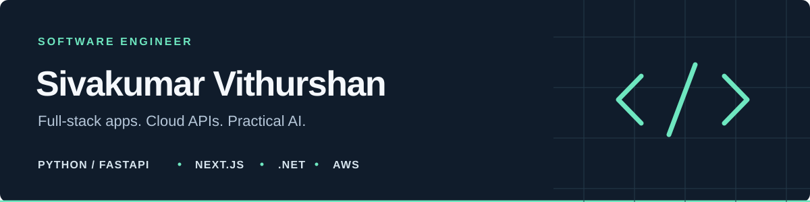

# Hi, I'm Vithurshan.

I'm a software engineer working across **full-stack development, cloud APIs, and practical AI**. My core stack is **Python/FastAPI, React/Next.js, TypeScript, and .NET**, with hands-on **AWS EC2** deployment work.

[LinkedIn](https://www.linkedin.com/in/vithurshan-sivakumar-a55b2379/) · [GitHub](https://github.com/sivavithu) · 
## Skills

- **Backend & APIs:** Python, FastAPI, SQLAlchemy, C#, ASP.NET Core, Entity Framework Core, REST APIs, JWT authentication.
- **Frontend & desktop:** React, Next.js, TypeScript, Tailwind CSS, Electron, Three.js.
- **Cloud & deployment:** AWS EC2, Linux, Docker, Nginx.
- **Object storage:** S3-compatible APIs, Boto3, presigned uploads and downloads.
- **Data & AI:** PostgreSQL, SQL Server, Turso / libSQL, Gemini API.
